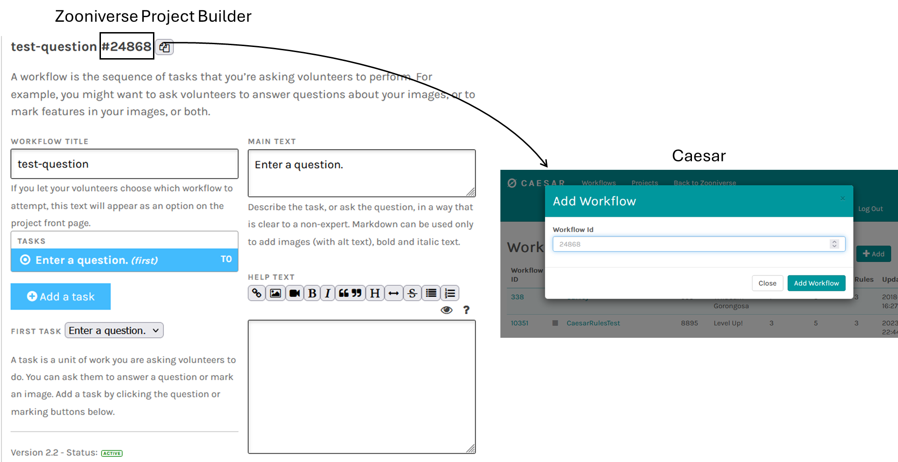
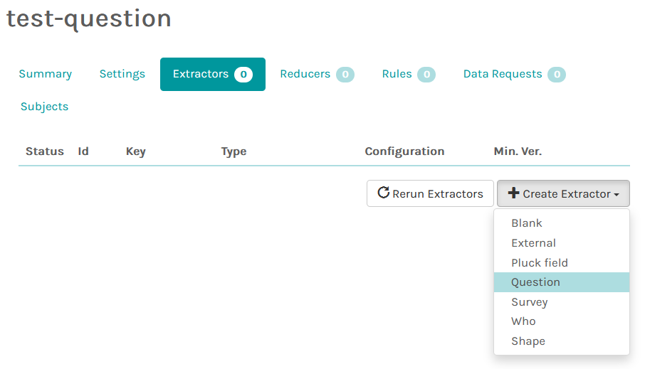
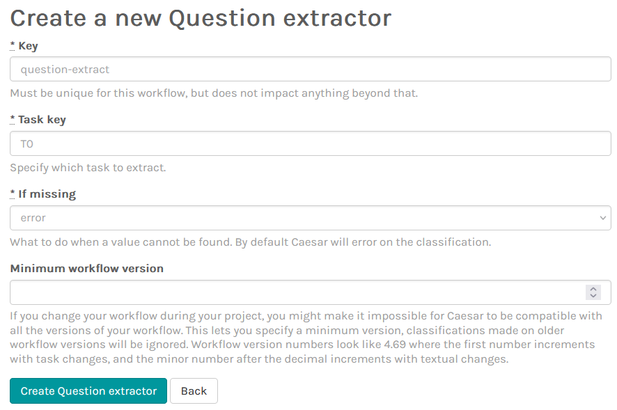
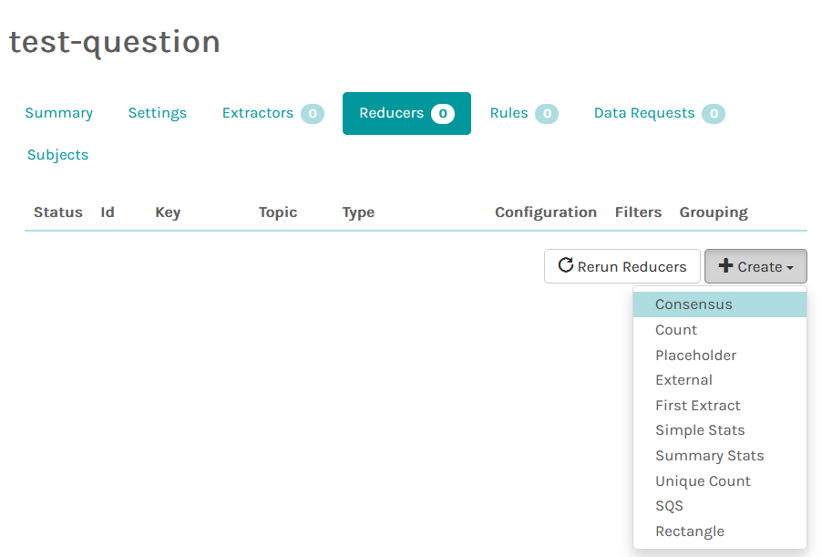
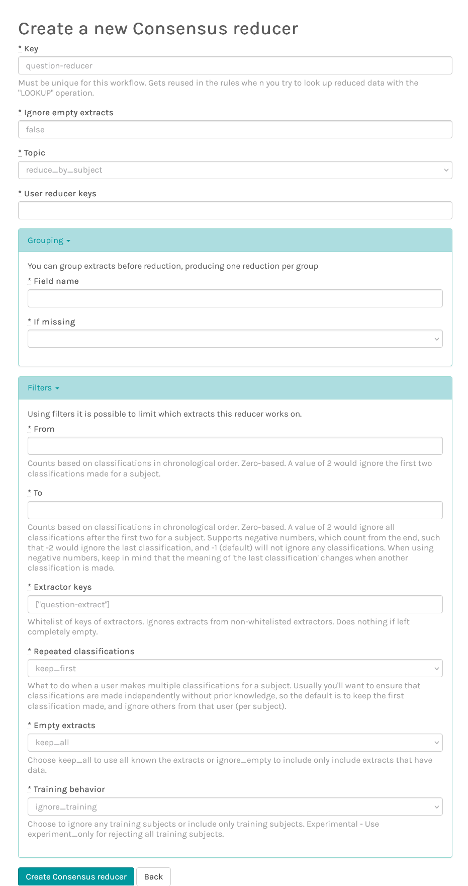

# Using Caesar: Aggregate Responses to a Question Task

This tutorial shows how to configure [Caesar](caesar.md) to combine volunteer
responses to **one question task** as classifications arrive. We will add an
existing workflow, create a Question extractor, then connect it to a Consensus
reducer. Rules and effects are optional and are not configured here.

For an explanation of Caesar's components, supported extractor and reducer
types, and automated actions, read
[Caesar: Zooniverse's Classification and Decision Engine](caesar.md) first.
For alternatives such as hosted batch aggregation and local processing, see
[Data Aggregation](data-analysis.md).

!!! note "About these screenshots"

    The screenshots were contributed in the original Data Analysis draft and
    illustrate the Caesar web interface. Labels and layout may change as the
    application evolves. Refer to the
    [official Caesar configuration guide](https://zooniverse.github.io/caesar/#usage)
    if your interface looks different.

## Before you begin

You will need:

* A Zooniverse account with access to configure the relevant project/workflow.
* An existing workflow containing a **Question** task, and its **workflow ID**
  from the [Project Builder](https://www.zooniverse.org/lab).
* The **task key** for the question, such as `T0`. A task key identifies a task
  within the workflow; it is **not** the workflow ID or workflow version.

For this example, imagine task `T0` asks **"Is there a glitch in this image?"**
with two answers: **Yes** (first option) and **No** (second option). We will
call the extractor `question-extract` and the reducer `question-reducer`.
These are example keys, not predetermined names; use keys that describe your own
workflow.

## 1. Add the workflow to Caesar

1. Sign in to the [Caesar web interface](https://caesar.zooniverse.org/workflows).
2. From **Workflows**, choose **+ Add**.
3. Enter the **workflow ID** displayed in your Zooniverse Project Builder and
   add the workflow.
4. Open the newly added workflow to access its Extractors and Reducers tabs.

*The workflow ID identifies the Zooniverse workflow that Caesar should process.
The screenshot uses an example workflow; enter your own ID.*

See [Adding Caesar to your workflow](caesar.md#adding-caesar-to-your-workflow)
for background and the
[official setup instructions](https://zooniverse.github.io/caesar/#usage).

## 2. Create a Question extractor

Open the Caesar workflow's **Extractors** tab, select **Create Extractor**,
then choose **Question**.

Configure the extractor:

| Field | Example value | What it controls |
| --- | --- | --- |
| **Key** | `question-extract` | A unique name for this extractor within the Caesar workflow; the reducer will reference it later. |
| **Task key** | `T0` | The specific question task to extract. Use your actual task key from the Project Builder. |
| **If missing** | `error` | What Caesar does when the expected task answer is absent; use another supported behavior only when it fits your workflow. |
| **Minimum workflow version** | Leave unset for this example | Optionally exclude classifications from earlier workflow versions. |

Select **Create Question extractor** to save it. For this simple example, the
extractor takes the answer to `T0` from each new classification, leaving aside
other task answers and unrelated metadata.

!!! note "Question answers use indices"

    Caesar's built-in Question extractor returns the **answer index**, not
    necessarily the human-readable label. Indices start at `0`, so in our
    example the first option (**Yes**) corresponds to `0` and the second
    (**No**) to `1`. Check the workflow definition when interpreting results.

!!! note "Workflow versions matter"

    A workflow's tasks and answer options can change between versions. The
    **minimum workflow version** setting can prevent incompatible earlier
    answers from being processed by this extractor. Decide where to set the
    cutoff based on the actual changes to your workflow; don't assume that
    all versions can be combined safely. See
    [Data Exports](data-exports.md#choosing-an-export) for a related distinction.

See the [extractor reference](caesar.md#step-1-extractors) and the
[official extractor configuration](https://zooniverse.github.io/caesar/#configure-extractors)
for more options.

## 3. Create a Consensus reducer

Open the workflow's **Reducers** tab. Select **Create**, then **Consensus**.

Configure the essential fields as follows:

| Field | Example choice | Why |
| --- | --- | --- |
| **Key** | `question-reducer` | A unique identifier for the resulting reduction, also usable by later rules. |
| **Topic** | `reduce_by_subject` | Combine volunteer answers for each subject, rather than combining one user's answers across subjects. |
| **Filters → Extractor keys** | `["question-extract"]` | Use only extracts produced by the Question extractor created above. |
| **Filters → Repeated classifications** | `keep_first` | If someone classifies the same subject more than once, use their first classification. |

For this first example, leave **Grouping** unconfigured and the remaining
settings at their defaults, unless your workflow has a specific reason to
handle missing extracts, training data, or repeat submissions differently.
In particular, the default training behavior should **not** be interpreted as
excluding training classifications automatically.

*The full reducer form includes additional settings beyond this example. The
screenshot reflects the original draft; check the live interface for current
labels and available values.*

Save the new Consensus reducer. The critical connection is that the
**Extractor keys** filter contains the exact key defined in Step 2. If the
names do not match, the reducer will not receive the intended extracts.

!!! note "Why filter by extractor key?"

    A workflow can have multiple extractors for different tasks or metadata.
    A Consensus reducer should be given only the compatible extracts relevant
    to the question being aggregated. The format for multiple extractor keys
    is described in the
    [official reducer filters reference](https://zooniverse.github.io/caesar/#filters).

Other reducer options—including default versus running reduction, grouping,
empty extracts, training classifications, and repeated submissions—are
explained in the [main Caesar reference](caesar.md#step-2-reducers) and the
[official reducer parameters](https://zooniverse.github.io/caesar/#reducer-parameters).

## 4. Understand the resulting reduction

Suppose three separate volunteers classify the **same subject** and answer
**Yes**, **Yes**, and **No**. The extractor selects the answer index from each
classification; the Consensus reducer combines the three extracted responses.

With **Yes** as option `0`, the illustrative result is:

| Output field | Example | Meaning |
| --- | --- | --- |
| `most_likely` | `0` (Yes) | The answer index receiving the most votes. |
| `num_votes` | `2` | Number of votes for that winning answer, **not** the total number of classifications. |
| `agreement` | Approximately `0.667` | Winning votes divided by the total included classifications (2/3). |

Actual data representation and results depend on the classifications included
and the reducer configuration. Check which workflow versions, repeat responses,
and missing or empty extracts were included when interpreting the result.

Caesar processes new classifications as they arrive. **Adding a workflow and
its configuration does not by itself establish that all historical
classifications have been processed.** If you need to reprocess earlier
classifications, consult the rerun controls and current project guidance
rather than assuming existing records were backfilled automatically.

For more information about how reductions are calculated, see the
[Consensus reducer reference](https://zooniverse.github.io/caesar/#consensus).
For broader interpretation guidance, see
[Data Aggregation](data-analysis.md#interpreting-the-results).

## 5. Optional: Use reductions to trigger actions

This tutorial ends with producing a reduction. You do **not** need to create a
rule simply to calculate a consensus. When a project also needs to make an
automated decision—such as retiring a subject after an agreed threshold or
routing it to another subject set—Caesar can evaluate a **rule** and execute
an associated **effect**. Test these decisions carefully before applying them
to a live project.

To continue this example, follow [Retire Subjects with Caesar](caesar-subject-retirement.md),
which builds a condition from the Consensus reducer's output. Refer back to
[Rules and effects](caesar.md#step-3-rules-and-effects) in the main Caesar guide,
or the
[official rules-and-effects configuration guide](https://zooniverse.github.io/caesar/#configure-rules-effects)
for detailed syntax and other effects.
