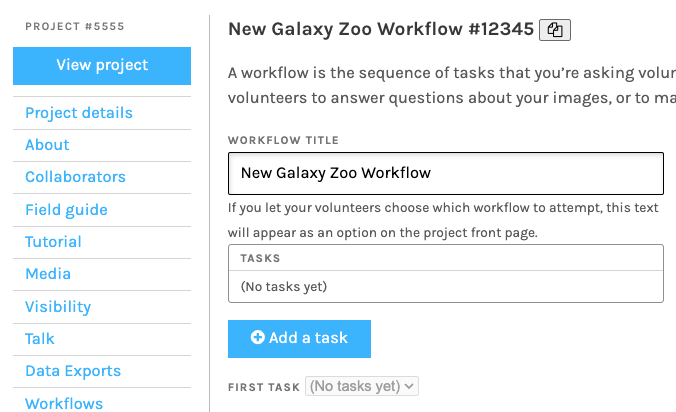

# Caesar: Zooniverse's Classification and Decision Engine

Caesar is Zooniverse's decision engine and real-time data processing pipeline.
It processes classifications as volunteers submit them, generating extracts and
aggregated results that can also trigger automated actions. Research teams use
Caesar to:

* **Retire subjects** when a configured condition is met.
* **Add subjects to subject sets or collections**, including sets used by other
  workflows for further review.
* Support more advanced projects using [Feedback](feedback.md),
  [transcription workflows](../transcription-project-guide/index.md),
  [Leveling Up](leveling-up.md), or
  [SWAP](https://zooniverse.github.io/caesar/#how-to-do-swap).

Caesar is especially useful when a project needs to process and act on
classifications as they arrive. For an introduction to extracting and combining
classifications, including **batch aggregation** alternatives, see
[Data Aggregation](data-analysis.md).

This page introduces Caesar's main components. For hands-on examples, see:

* [Aggregate responses to a question task](caesar-question-aggregation.md) —
  configure an extractor and a Consensus reducer.
* [Retire subjects using rules and effects](caesar-subject-retirement.md) —
  build on a reduction to configure an automated retirement decision.

For the complete parameter documentation, see the
[API and configuration reference](https://zooniverse.github.io/caesar/).
For questions, contact [contact@zooniverse.org](mailto:contact@zooniverse.org).

## Adding Caesar to your workflow

In the [Caesar web interface](https://caesar.zooniverse.org/workflows), sign in,
select **+ Add** from the Workflows page, and enter the ID of an existing
Zooniverse workflow. You can find the workflow ID on its page in the
[Project Builder](https://www.zooniverse.org/lab).

*Figure 1: Finding the project and workflow IDs in the Project Builder.*

Once the workflow is added to Caesar, configure extractors and reducers to
process its classifications. For a guided example of these steps, see the
[question aggregation tutorial](caesar-question-aggregation.md).
Add rules and effects if you also want Caesar to act on the results. See the
[official setup instructions](https://zooniverse.github.io/caesar/#usage)
for the full configuration workflow. The
[Panoptes Python Client](https://panoptes-python-client.readthedocs.io/en/latest/user_guide.html#tutorial-adding-a-workflow-to-caesar)
also provides a programmatic way to register a workflow with Caesar.

## How Caesar works

Caesar follows an **extract → reduce → act** process:

1. **Extractors** select data from individual classifications.
2. **Reducers** combine extracts into results for a subject or user.
3. **Rules and effects**, when configured, evaluate those results and trigger
   actions. This third step is optional: a project can use Caesar to generate
   reductions without using automated decisions.

### Step 1: Extractors

An **extractor** selects task-specific data from a classification and prepares
it for reduction. Common extractor types include:

* **Blank Extractor** — Checks for empty responses in supported task types.
* **Question Extractor** — Retrieves the selected answer index for a question
  task. Answer indices start at `0`.
* **Pluck Field Extractor** — Retrieves a value from classification data or
  subject metadata.
* **Survey Extractor** — Handles survey task responses.
* **Shape Extractor** — Handles annotations made with drawing tools.
* **External Extractor** — Sends classification data to a custom HTTPS endpoint
  and receives an extracted result, allowing project-specific processing.

When configuring an extractor, identify the relevant **task key** (for example,
`T0`). You can also set a **minimum workflow version** to exclude earlier
classifications when a workflow has changed. See the
[extractor types](https://zooniverse.github.io/caesar/#extractor-types) and
[configuration instructions](https://zooniverse.github.io/caesar/#configure-extractors)
for details.

### Step 2: Reducers

A **reducer** combines extracts into an aggregated result, usually grouping
classifications by subject. Caesar can also reduce by user. The reducer type
and its configuration determine which fields appear in the resulting reduction.

The [Caesar API reference](https://zooniverse.github.io/caesar/#reducer-types)
documents these built-in reducer types:

* **Consensus Reducer** — Finds the most likely answer from compatible
  extracted values and returns fields including `most_likely`, `num_votes`,
  and `agreement`.
* **Count Reducer** — Counts classifications and corresponding extracts,
  returning `classifications` and `extracts`. It does **not** count votes for
  each answer option.
* **Simple Stats Reducer** — Sums numeric values in extracted key-value pairs.
  For example, it can total counts for different survey choices; it does
  **not** calculate a mean or variance.
* **First Extract Reducer** — Returns the first extract, useful when carrying
  through information such as subject metadata.
* **Rectangle Reducer** — Groups rectangle annotations using a clustering
  algorithm.
* **SQS Reducer** — Sends extracts to an AWS SQS queue for processing by an
  external service; configuration involves the queue details.
* **External Reducer** — Sends extracts to a custom HTTPS endpoint that
  performs the reduction.

These are the reducers described in the public API reference, not necessarily
an exhaustive list of options in the web interface. Check the current
interface and documentation before choosing a less familiar reducer type.

!!! note "Default and running reduction"

    In **default reduction** mode, Caesar fetches the relevant extracts each
    time it recalculates a result. **Running reduction** uses newly arrived
    extracts and stored intermediate state, which can be more efficient for
    large groups but requires additional care. Start with default reduction
    unless your use case calls for running reduction; running mode is not
    recommended for external reducers. See the
    [reduction mode reference](https://zooniverse.github.io/caesar/#reduction-mode).

For specialized online extractors and reducers, Caesar can also integrate with
the Zooniverse-hosted Aggregations application. For separate, local batch
processing, see the [Panoptes Aggregation package](https://aggregation-caesar.zooniverse.org/docs)
and our [Data Aggregation guide](data-analysis.md).

### Step 3: Rules and effects

A **rule** evaluates a condition, often based on fields in a reduction. If the
condition is true, Caesar runs the **effect or effects** associated with that
rule. Conditions can be combined using logical operators, and rules can act on
subjects or users. The [rules reference](https://zooniverse.github.io/caesar/#rules)
describes the supported condition syntax.

Subject-rule effects include:

* **Retire a subject** when a configured criterion has been met, supplying a
  retirement reason.
* **Add a subject to a subject set or collection**, for example a set associated
  with a follow-up workflow.
* **Call an external HTTPS endpoint** to trigger custom downstream processing.

Caesar also supports user-rule effects, such as promoting a user to a workflow.
For a guided subject-retirement example, see
[Retire Subjects with Caesar](caesar-subject-retirement.md).
See the [effects reference](https://zooniverse.github.io/caesar/#effects)
for configuration options. Rules and effects are optional when you only need
Caesar's aggregated results.

For the difference between real-time processing and other aggregation methods,
see [Data Aggregation](data-analysis.md). For the detailed web-interface setup,
including extractor parameters and reducer filters, refer to the
[official Caesar usage guide](https://zooniverse.github.io/caesar/#usage).
