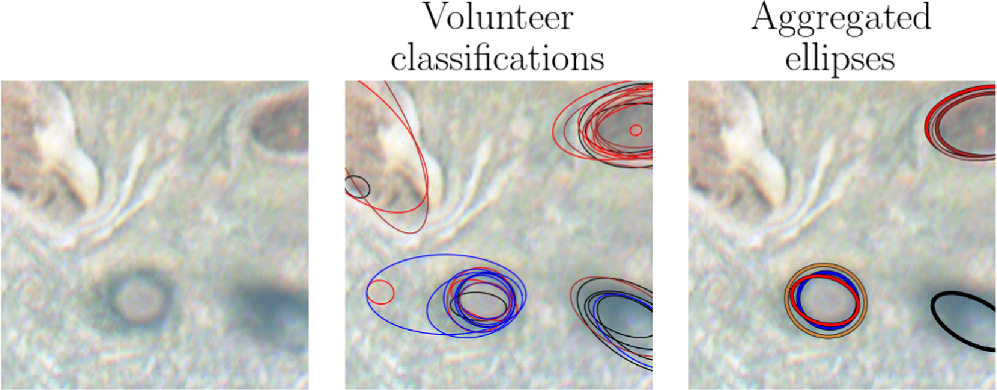
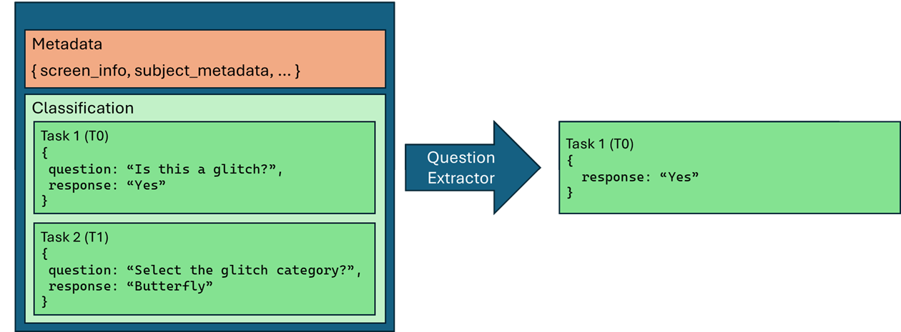
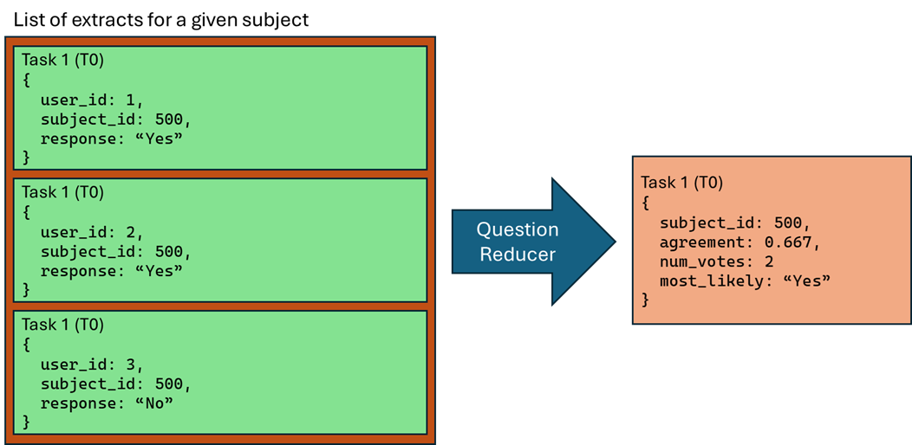

# Data Analysis & Aggregation

Zooniverse classifications record the answers and annotations submitted by
individual volunteers. Most research projects need to combine multiple
classifications into a consensus answer before using the results in further analysis. 
The appropriate method for aggregating classifications depends on the type and complexity of annotations
collected, and whether real-time processing is needed.

This page explains the stages of aggregation and introduces the tools available
to project teams. For information about obtaining classification exports, see
[Data Exports](data-exports.md).

## From Subjects to Aggregated Results

Data takes three different forms as it moves through a Zooniverse project:

1. **Subject Data:** A subject is the raw material presented to volunteers, such as
   an image, audio recording, video, or text, together with its associated
   metadata.
2. **Individual Classifications:** Each classification contains the answers and
   annotations submitted by a single volunteer for a subject in a particular workflow.
   A classification may include responses to several tasks.
3. **Consensus Result:** When multiple classifications are combined, averaging over
   the "wisdom of the crowd", the aggregated result is a consensus answer.

The figure below provides a visual representation of these three stages from the [Jovian Vortex Hunter](https://www.zooniverse.org/projects/ramanakumars/jovian-vortex-hunter) project: the subject image (left), individual volunteer-drawn ellipses around features (center), and aggregated ellipses created through clustering and averaging of individual results (right).

Zooniverse aggregation tools process volunteer contributions and produce three sequential data products: **classifications, extractions, and reductions**:

1. **Classifications:** The complete contribution produced by a single volunteer on a workflow for a given subject. May consist of multiple components, one for each task included in the workflow.
2. **Extractions:** The output of an *extractor* that selects and structures relevant information from an individual classification. For a question task, it might retrieve the selected answer; for a drawing task, it might retrieve the coordinates or shape parameters of an annotation.
3. **Reductions:** The output of a *reducer* that combines multiple extracts for a single subject into a combined result. Depending on the task and reduction method, the output might be a majority answer, vote counts, agreement statistics, clustered points, or combined shapes.

### Example: extracting and reducing classifications for question task

Consider a workflow that asks volunteers whether an image contains a glitch.
Here, a **classification** includes answers to two tasks, along with metadata.
A **question extractor** is used to select the response for the "Is this a glitch?" question task, filter out
unrelated task responses, and ignore unnecessary metadata from the classification.

*Question Extraction: only the response to the `T0` "Is this a glitch?" question task is retained in this
illustrative extract.*

Suppose three volunteers classify the same subject: two answer
**Yes** and one answers **No**. A **consensus reducer** combines those three extracts to
compute a consensus label.

*Consensus Reduction: three individual extracts for a subject are combined and a consensus is computed, with majority Yes response and agreement of a majority response of 2/3~0.667.*

## Choosing an Aggregation Process

Zooniverse offers several ways to process classification data. They serve
different needs and do not necessarily support the same tasks or configuration
options.

| Method | When to consider it |
| --- | --- |
| **Batch Aggregation** | For simple workflows that do not require complex configuration of extractors and reducers, a Zooniverse-hosted service will perform aggregation at the push of a button. No need for installing software or running processing locally. (Under Development) |
| **Running Aggregation Software Locally** | Install and run the `panoptes_aggregation` Python package's command-line tools or graphical interface on your local computer when you need more control over workflow versions, extractor and reducer configuration, and interative processing. |
| **Real-time Processing with Caesar** | Use Caesar when classifications should be processed in near real-time, especially if you want to trigger actions such as subject retirement or routing to another subject set based on results. |
| **Custom Scripts** | Use of Zooniverse aggregation tools is not required and many research teams create their own processing pipelines and scripts to handle the specific needs of their project. A number of example scripts are available in the [Data Digging repo](https://github.com/zooniverse/Data-digging). |

Text transcription projects may also use specialist tools and review workflows;
see the [Transcription Project Guide](../transcription-project-guide/working-with-data.md#73-data-aggregation).

### Batch Aggregation

*This feature is currently under development; public launch is targeted for 2027.*

Batch aggregation processes an existing collection of classifications rather
than continuously processing new submissions. It is intended for standard,
supported workflow tasks; it does not provide all the configuration options
available when running the aggregation package yourself.

The **Aggregate My Results** section of your project's **Data Exports** page
facilitates the Zooniverse-hosted batch aggregation processing. Before configuring a batch
aggregation, request both a **Workflow Classification** export and a
**Workflows** export. The batch aggregation job requires these two exports as input; see [Data Exports](data-exports.md).

Batch aggregation can also be requested using the Panoptes Python Client; see [Python Client documentation](https://panoptes-python-client.readthedocs.io/en/latest/user_guide.html#automated-aggregation-of-classifications)
for more information.

### Running Aggregation Software Locally

The `panoptes_aggregation` Python package ([docs](https://aggregation-caesar.zooniverse.org/docs); [Github repo](https://github.com/zooniverse/aggregation-for-caesar)) allows researchers to perform aggregation using Zooniverse-maintained code on their local computer. The software can be installed and run from the command line or using an optional graphical interface, and enables full control of extraction and reduction functionality. The same software is used by the hosted Batch Aggregation service, but running the code locally allows more complex processing and configuration.

Processing consists of obtaining the required classification and workflow exports, configuring appropriate extractors and reducers, and running the extraction and reduction steps.

!!! note "Check Workflow Versions"

    A workflow classification export includes all classifications from the selected workflow, which may have been produced by multiple versions of the workflow. The `panoptes_aggregation` code will ask for a specific workflow version, or range of versions over which it will aggregate. If a workflow's tasks changed significantly, classifications from different versions may need to be reduced separately.

### Real-time Processing with Caesar

[Caesar](caesar.md) receives classifications for configured workflows as volunteers submit them. Its
extractors and reducers can produce near real-time results, and its **rules and
effects** can act on those results. For example, a project might retire a
subject after meeting a specified criterion or send it to another workflow
for additional review.

Caesar is best used for its hosted, near real-time processing. While it is possible 
to export extracts and reductions from Caesar, this is not the app's primary objective.
For an overview of its extractor, reducer, and rule options, see the [Caesar guide](caesar.md).
For a worked example using a Question extractor and Consensus reducer, see
[Using Caesar: Aggregate Responses to a Question Task](caesar-question-aggregation.md).
For a follow-up example that uses those reductions to make decisions, see
[Retire Subjects with Caesar](caesar-subject-retirement.md).
